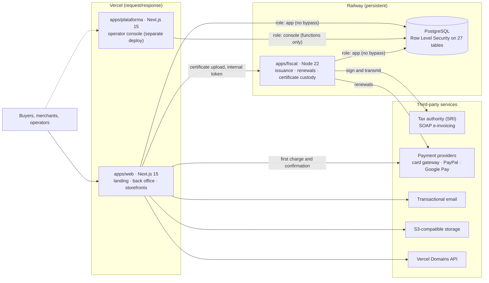
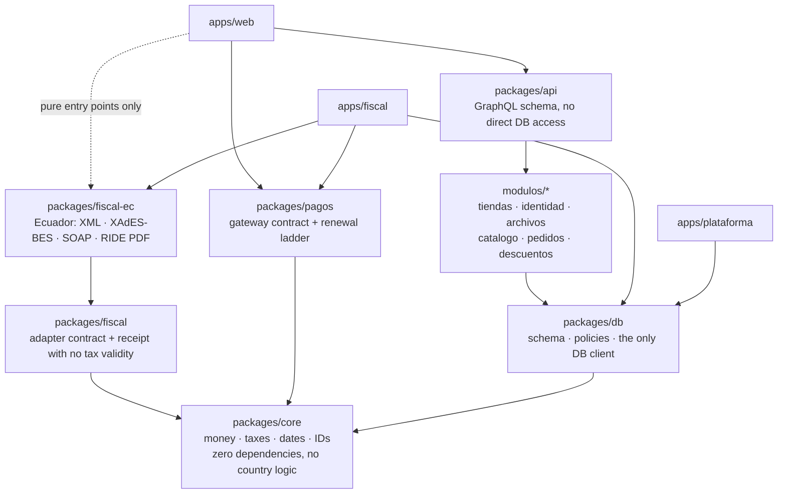
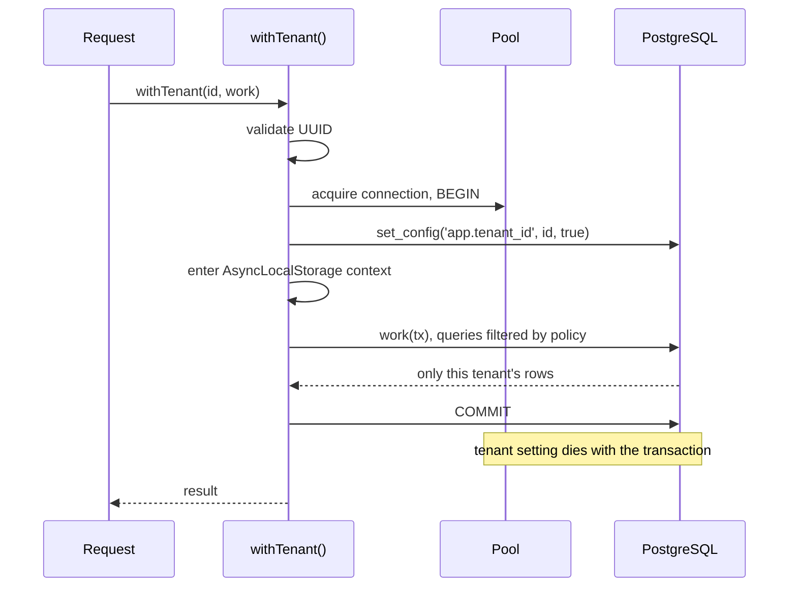
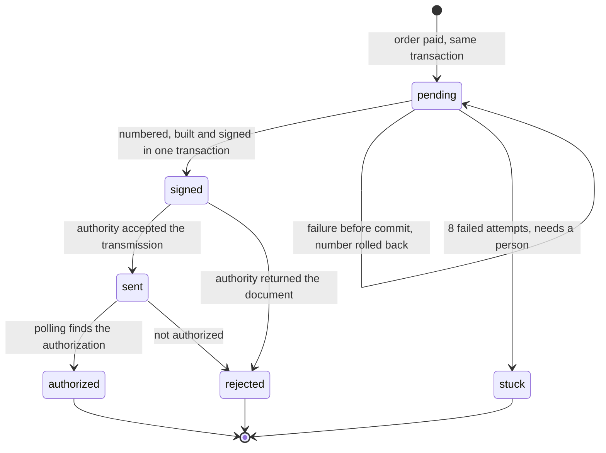

<div align="center">

# Faynit

### A multi-tenant commerce SaaS where every paid sale issues its own legally valid e-invoice

**Case study · Private repository · Pre-launch product**

**[Visit the live site → faynit.com](https://faynit.com/)**


</div>

---

| | |
|---|---|
| **Role** | Founder and sole engineer: product, architecture, full-stack development, DevOps and technical documentation |
| **Domain** | Multi-tenant SaaS, e-commerce, payments, subscription billing, electronic invoicing |
| **Market** | Ecuador first, with the country isolated behind an adapter so it can be replaced |
| **Timeline** | About 5 weeks of intensive delivery (23 Sep to 29 Oct 2026) · 38 commits · 8 merged pull requests |
| **Status** | Pre-launch. The landing page is live and the product is deployed on Vercel and Railway. E-invoicing is verified against the tax authority's certification environment. Real charges and production invoicing are not switched on yet ([details](#3-current-status)) |

---

## Table of Contents

1. [Executive Summary](#1-executive-summary)
2. [Privacy Notice](#2-privacy-notice)
3. [Current Status](#3-current-status)
4. [Architecture & Tech Stack](#4-architecture--tech-stack)
5. [Deep Dive: Technical Challenges & Solutions](#5-deep-dive-technical-challenges--solutions)
6. [Key Metrics](#6-key-metrics)
7. [Engineering Practices](#7-engineering-practices)
8. [Skills Demonstrated](#8-skills-demonstrated)

---

## 1. Executive Summary

Small merchants in Ecuador sit between two kinds of tools. Store builders capture clean sale data but leave the legally required electronic invoice to add-ons. Invoicing tools produce the invoice but make someone retype the sale. A merchant ends up doing both, by hand, after every sale.

**Faynit closes that gap.** The store exists to capture who bought, what they bought, at what price and with what ID. That data is what lets the invoice issue itself.

I designed and built the whole product:

- **A multi-tenant storefront platform.** Every merchant gets a store on its own subdomain or custom domain, with a catalog, cart, checkout, coupons, shipping zones, abandoned-cart recovery and an order pipeline.
- **A merchant back office.** Orders, products with variants, customers, reports, team invitations, settings, and a free-form visual store editor with nine starting templates.
- **Automated electronic invoicing.** XML generation, XAdES-BES digital signing, SOAP transmission to the tax authority (SRI) and authorization polling, all triggered by a paid order, in a separate persistent service.
- **Custody of each merchant's signing certificate,** using envelope encryption in a process that is the only one holding the master key.
- **Subscription billing for the SaaS itself,** with embedded payment methods, automatic renewals, a retry ladder, delinquency and suspension.
- **A typed GraphQL API** for the web and a future mobile client, over a modular monolith whose boundaries are checked by tests.
- **An operator console** with its own database roles and an audit trail written by the database.

Two failures define this system. The first is one merchant seeing another merchant's data. The second is a tax document issued under the wrong identity or with the wrong amount. Neither one produces a stack trace: a leak just returns rows, and a wrong invoice gets accepted and filed.

So the guiding principle is **a rule that matters gets enforced by the database or by a failing test, never by convention.** Tenant isolation lives in PostgreSQL policies. Stock and coupon limits live in conditional updates and `CHECK` constraints. Module boundaries live in a test that reads the source code. A new table without an isolation policy fails CI, with no need for anyone to remember to add it.

The result is **636 automated tests, 200 of them against a real PostgreSQL**, running on every push, and a first invoice authorized by the tax authority's certification environment, end to end and without human intervention.

---

## 2. Privacy Notice

> [!NOTE]
> **Faynit is my own proprietary product and its source code lives in a private repository.**
>
> This case study is written so a reviewer can judge the engineering without exposing a product that is still being built:
>
> - **No source code, credentials, infrastructure identifiers, tax IDs or customer data** appear in this document.
> - Code fragments are **illustrative pseudocode** of well-known patterns, not excerpts from the codebase.
> - The codebase is written in Spanish. Identifiers here are translated, so names in the pseudocode won't match the source one to one.
> - Every number in this document was measured from the repository or from its CI on 30 October 2026.
>
> I'm happy to walk through the architecture, the design records or selected parts of the code **in a live session**.

---

## 3. Current Status

A case study is only useful if the reader can tell what has been proven from what has been built. This is where Faynit stands.

| Capability | State | Evidence |
|---|---|---|
| Storefront, back office, editor, checkout | **Built and deployed** | Walked through in a browser from signup to a paid order; all nine templates taken to a confirmed order |
| Tenant isolation | **Built and enforced** | 200 tests against real PostgreSQL on every push |
| E-invoicing | **Verified in the certification environment** with one taxpayer | First invoice authorized on 30 Sep 2026, signed with a real CA-issued certificate |
| PayPal | **Sandbox verified** for order creation | Buyer approval and a real vaulted renewal still pending |
| Card gateway | **Built, not yet run against a live account** | Tested through a simulated gateway and a stubbed API |
| Google Pay | **UI built, processor undecided** | Research showed the planned processor isn't on Google's list ([Challenge 7](#challenge-7--subscription-billing-when-a-timeout-says-nothing)) |
| Subscription renewals | **Built, no real money moved** | Retry and suspension ladder exercised against the simulated gateway |
| Custom domains | **Built** | Pending a connection test against the production Vercel account |
| Operator console | **Built and tested locally** | Not deployed yet |

**What isn't built yet:**

- Credit and debit notes, and emailing the invoice PDF and XML to the buyer.
- Issuing under a second taxpayer, which is what will prove the certificate custody across tenants in practice.
- Re-sending a document whose transmission failed ([Challenge 3](#challenge-3--an-issuance-pipeline-that-doesnt-burn-numbers)).
- Reconciling uncertain charges against the gateway ([Challenge 7](#challenge-7--subscription-billing-when-a-timeout-says-nothing)).
- The operational hardening phase, including observability and abuse limits. It's scheduled before the product opens to paying customers.
- A dedicated mobile layout for the free-form canvas. Stores currently scale down proportionally.

---

## 4. Architecture & Tech Stack

### 4.1 System Overview



**Two deployments, one database, and it isn't a preference.** Next.js on serverless can't host the fiscal engine, for four concrete reasons:

1. Issuance runs as **persistent jobs every 60 seconds**, serialized with PostgreSQL advisory locks and partitioned by tenant.
2. Signing opens **PKCS#12 files in pure JavaScript** (`node-forge`), because legacy PKCS#12 ciphers are rejected by OpenSSL 3 defaults.
3. The tax authority's load balancer sometimes answers with a **`302` to a bare IP**, which needs explicit redirect control and stateful retries.
4. It's the **only process that holds the master key** for merchants' certificates, and it has no reason to share a runtime with public traffic.

A timer that lives between requests also makes overlapping runs impossible. With an external cron calling an endpoint, overlap is routine, and here an overlap means two charges to the same merchant.

### 4.2 Monorepo and Dependency Direction

Fifteen npm workspaces, with dependencies pointing in one direction:



`core` has no dependencies at all. The day it imports a country package, Ecuador stops being a module and goes back to being an assumption. The web app imports only pure sub-entry points of the Ecuador package (tax rates, provinces, ID validators, onboarding rules), so the signing engine, the SOAP client and the certificate code never load in the process that serves public traffic.

### 4.3 Tech Stack

| Layer | Technologies | Why |
|---|---|---|
| **Web** | Next.js 15, React 19, TypeScript, Tailwind CSS 4, Framer Motion, dnd-kit, Zod | One codebase serving three hosts; server components for reads; typed validation at every boundary |
| **API** | GraphQL Yoga, Pothos (relay, complexity, scope-auth plugins), DataLoader, urql, gql.tada | A single typed contract for web and mobile, with a versioned schema file and operation cost limits |
| **Background service** | Node.js 22 with a plain `http` server and chained timers | A long-lived process with no framework between it and the jobs |
| **Data** | PostgreSQL 17, Prisma 6, hand-written SQL migrations for policies, roles, triggers and functions | The rules no ORM can express live in the database |
| **Fiscal** | XAdES-BES signing (`ec-sri-invoice-signer`, `node-forge`), `fast-xml-parser`, SOAP over `fetch`, generated RIDE PDF | Legally valid documents signed in the server process |
| **Payments** | Payphone (embedded box), PayPal (JS SDK and vault), Kushki with Google Pay, and a scripted simulated gateway | One contract behind every provider; card numbers never reach my servers |
| **Security** | `scrypt` passwords, AES-256-GCM envelope encryption, HKDF, HMAC-signed cookies, SHA-256-hashed tokens, role-separated PostgreSQL access | Built on `node:crypto`, avoiding native build dependencies |
| **Media** | Sharp (WebP pipeline), S3-compatible storage with a hand-written SigV4 signer | Originals and their metadata are never stored |
| **DevOps** | GitHub Actions, Vercel, Railway, Docker Compose for local PostgreSQL | A clean environment on every push, with a real database |
| **Testing** | Vitest 4: unit, architecture and isolation suites | Tests the policies, locks and triggers against the real engine, not a double |

### 4.4 Non-Negotiable Rules

Nine rules govern the codebase. Each one has something that pushes back when it's broken:

| # | Rule | Enforced by |
|---|---|---|
| 1 | **Every business table has `tenant_id`, RLS, `FORCE` and a policy** | A test reads the PostgreSQL catalog and fails if a new table is missing any of them |
| 2 | **Every index starts with `tenant_id`,** or is listed with a written reason | A test over `pg_index`, with 5 documented exceptions |
| 3 | **No query runs outside a tenant-scoped transaction** | The raw client isn't exported, and the exported one throws |
| 4 | **Money only moves through the money module.** Never `number`, never `float`, never `toFixed` | `bigint` minor units, with non-integer input rejected at runtime |
| 5 | **The core carries no country logic** | One-way package dependencies; `core` has no dependencies to import a country from |
| 6 | **Natural keys are composite** (`tenant + slug`) | Unique constraints: two stores may both call a category "shirts" |
| 7 | **Each table has one owning module,** and only that module queries it | A static test parses every source file |
| 8 | **Clients read and write through the GraphQL API.** Amounts travel as decimal strings | The versioned `.graphql` contract is generated and reviewed as such |
| 9 | **Migrations are append-only** | Prisma checksums the file bytes, so an edited migration shows up as drift |

---

## 5. Deep Dive: Technical Challenges & Solutions

### Challenge 1 · Tenant isolation that holds even when application code is wrong

**Context.** In a shared-schema SaaS, a missing `WHERE tenant_id = ?` breaks nothing visible. It quietly returns another company's orders. A protection that depends on every developer remembering a filter on every query will fail eventually, and the failure is silent.

**What I built.** Isolation is enforced by **PostgreSQL Row Level Security**, so it holds even if the application code has a bug:

```sql
-- illustrative pattern, applied to all tenant-scoped tables
ALTER TABLE orders ENABLE ROW LEVEL SECURITY;
ALTER TABLE orders FORCE  ROW LEVEL SECURITY;

CREATE POLICY isolation ON orders FOR ALL
  USING      (tenant_id = (SELECT current_tenant_id()))
  WITH CHECK (tenant_id = (SELECT current_tenant_id()));
```

Row Level Security has three well-known traps that make it decorative, and each one is closed:

1. **`FORCE` isn't optional.** A table owner ignores RLS by default. Every table enables both, **and** the app connects as a role that owns nothing and is explicitly `NOBYPASSRLS`. They're two independent locks on purpose: if someone adds a table and forgets `FORCE`, the role separation still holds.
2. **`SET LOCAL` only lives inside a transaction.** With a connection pool, a loose query could inherit the tenant of the previous request or have none at all. So every unit of work opens a transaction, sets the tenant with `set_config(..., true)` and runs inside it. The connection returns to the pool clean.
3. **Performance.** Wrapping the tenant function in a subselect makes PostgreSQL evaluate it once per query as an `InitPlan`, not once per row. Every index leads with `tenant_id`, and a test verifies that against `pg_index`.

The request path looks like this:



**The application-side guard.** The Prisma client exported to the codebase is wrapped in an extension that **throws** if a model operation runs outside that context. This isn't the security mechanism (PostgreSQL is), it's a net that turns a mistake into an immediate error.

**Failing closed.** The tenant function returns `NULL` when nothing is set, so the comparison is `NULL` and **no rows come back**. A forgotten context produces an empty screen, never a leak. A trigger also rejects any change to a row's `tenant_id`.

**Six gates, and a test that counts them.** There are exactly six moments when the tenant can't be known yet: resolving a host, creating a tenant, finding the accounts of an email at login, and three job queues that span all tenants. Each is a `SECURITY DEFINER` function owned by a `NOLOGIN` role, and it returns the minimum possible. The three queues return **only UUIDs**. The real work then happens inside a normal tenant-scoped transaction.

I rejected the shorter alternative of giving the fiscal service a `BYPASSRLS` role. That role would see every catalog, order and certificate, and it's the role running the code that talks to the internet. A test asserts the gates are exactly those six, so a seventh can't appear without someone reasoning about it.

**Traps found during implementation:**

| Trap | Symptom | Resolution |
|---|---|---|
| Prisma queries are lazy promises | The guard threw *inside* a valid context: 14 red tests blaming the caller. With `run(ctx, () => work(tx))`, the promise was consumed after the context had ended | `await` inside `run`, so the query executes within the context |
| `BYPASSRLS` isn't the same as having privileges | Tenant creation failed with `permission denied for table plans`, pointing at the table instead of the function | Explicit, minimal `GRANT`s for the resolver role, and none on the certificates table |
| RLS checks the new row's tenant, not its parent's | An event from store A could hang off an order from store B | Composite foreign key `(tenant_id, order_id)` on the order timeline. Older child tables are scheduled to get the same treatment |
| `GRANT SELECT, INSERT` takes nothing away | Default privileges still allowed updating the "append-only" timeline. The test found it | An explicit `REVOKE`. To remove a permission you have to remove it, not just avoid granting it |
| Each hot reload opened a new connection pool | After a while editing, 97 idle connections and `remaining connection slots are reserved`, in the app and in the test suite | The client lives on `globalThis` outside production |

**Outcome.** The isolation suite seeds two tenants with **identical data** and checks that no read, write, aggregate, nested relation, raw query, `updateMany` or `deleteMany` crosses the boundary. A second suite checks the database catalog itself, which is what protects **tables that don't exist yet**. If it goes green because someone relaxed it, the product can no longer be sold to two companies, so the repository's rules forbid relaxing it.

---

### Challenge 2 · A country as a plug-in: the fiscal core

**Context.** Ecuador is the first market, not the only possible one. Colombia and Peru use different document formats (UBL 2.1 against Ecuador's own XML), different signature algorithms (Peru signs with SHA-256, Ecuador with SHA-1) and require legal registration with each tax authority. If Ecuador leaked into the core, every new country would be a rewrite.

**What I built.** A ports-and-adapters design, where the core talks about a *fiscal document*, a *provider reference* and a *two-level series*, and the adapter translates:

| Core columns | Country payload (`JSONB`) |
|---|---|
| `status`, `currency`, `total_minor`, `local_issue_date` | The 49-digit access key |
| `provider_reference`, `authority_state` | Establishment, emission point, sequence number |
| `attempts`, `last_error_*` | The declared provider's tax ID |

The Ecuador adapter started from an e-invoicing engine I had already taken to production on an earlier project. The logic and its hard-won rules carried over. What I rewrote was the boundary: data now comes from a multi-tenant core instead of environment variables, and amounts live in the money module instead of `number`.

The contract is small: validate the issuer, resolve the series, build, sign, transmit, query, render the printable version, and validate an ID. `build` is **deliberately synchronous**, so nobody can put a network call inside the transaction that holds a reserved sequence number.

**Resolution by registry, not `switch`.** The Ecuador package registers a **lazy factory** at the startup of the fiscal service. That avoids an import cycle between packages, and it keeps the signing engine out of the web process entirely.

**Day-one provisions.** Six decisions that cost the same today as their coupled version and would be a rewrite later:

- **Money** carries its currency's exponent, because the Colombian peso has no minor unit in commercial practice. A module that assumes "×100" produces prices a hundred times too large, silently.
- **Taxes** are a list of components, not a `tax_rate` column, since Ecuador has VAT plus a special consumption tax. Rates are frozen on the sale line, so a credit note today against a 2023 invoice carries the 12% of that time.
- **Dates** are `timestamptz` plus a `local_issue_date` computed from the tenant's timezone. A sale at 23:30 in Guayaquil is the next day in UTC.
- **Identification** is `{ type, value, country }` with a validator injected by the adapter. **No `cedula` or `ruc` column exists anywhere in the schema.**
- **Territory** comes from the adapter. Shipping zones store province codes, so a country with no list simply offers no zones.
- **Language-prefixed routes** (`/es`) exist from the first commit, because adding them later means redirecting every indexed URL.

**A receipt that says what it is.** A country with no adapter still sells, and issues a receipt with **no tax validity**. It says so in four places: a capability flag, the returned status, the payload and the PDF itself, large and at the top. That fallback is dangerous exactly to the extent it's disguised.

**The incident that shaped the registry.** The registry returned that generic adapter whenever no adapter was registered for a country, which treated two very different cases the same way: *this country has no adapter* and *this process forgot to register it*. A test run in a process that hadn't registered Ecuador issued a demo document as a tax-invalid receipt, marked as issued, with its sequence number spent, and nothing failed. In a misconfigured deployment that would have happened to every invoice of the day, silently.

The registry now **throws** when a country declared as having an adapter resolves to none, and the failure message explains exactly what went wrong.

**Honest limit.** The boundary hasn't been proven by a second country. The evidence so far is that the fiscal types read without knowing which country the product runs in. A real second adapter is a matter of quarters, because each one needs a legal entity and a government authorization before any code.

---

### Challenge 3 · An issuance pipeline that doesn't burn numbers

**Context.** Ecuadorian invoices are numbered sequentially per emission point, and a number the tax authority has seen is gone for good. A rejected document can't reuse it. The authority also has outages and slow responses, and the sale must never depend on its availability.

**What I built.** Payment **enqueues** and returns. Enqueueing happens inside the same transaction that marks the order paid, so a paid order can't lose its document, and a slow tax authority can't hold up a customer's checkout. A job does the rest:



**Two steps, deliberately separated:**

- **Reserve the number, build and sign in one transaction.** The sequence is a row updated with `UPDATE ... RETURNING`, not a PostgreSQL `SEQUENCE`, because `nextval()` doesn't roll back and would leave permanent gaps.
- **Transmit outside the transaction.** A network call takes seconds and sometimes thirty. Holding that row locked would block every other document of that emission point.

The `signed` state is what stops a retry from reserving **a second number** for the same document.

**Locks partitioned by tenant.** Job instances serialize with `pg_try_advisory_xact_lock(job_class, hashtext(tenant_id))`. A single global lock would let one slow document block every other merchant. The transaction-scoped variant matters too: a session-level lock could end up unlocked from a different pooled connection. A hash collision only makes two tenants queue behind each other, and two processes can never hold the same tenant at once.

**Job mechanics.** Passes run on chained `setTimeout`, not `setInterval`, so a slow pass can't overlap itself. A failed document never stops the pass, because the next one may belong to another tenant. Authorization polling runs on a 73-second cycle against issuance's 60, offset so both don't hit the authority in the same instant. A document that fails 8 times moves to `stuck`, a state that requires a person, because at that point the cause is bad data and not the network.

**Two independent production brakes:**

1. The tenant's data decides what gets **written**: a store stays in `test` until an onboarding step records completion.
2. A process-level flag decides what gets **sent**, and it fails safe. Only one exact value unlocks production. Empty, `true`, `1` or a stray space all keep the brake on.

A blocked document is **skipped, not failed**. Recording a failure would burn its attempts, and on the day someone lifts the brake, a document that was never tried would already be stuck.

**Protocol behavior no specification mentions:**

| Behavior | Consequence | Handling |
|---|---|---|
| The authority's parser rejects self-closing tags | Serializers emit `<tag/>` by default, and the failure appears on the first real invoice | XML is built by hand |
| `xs:sequence` order is strict | A correct field in the wrong place is rejected like a missing one | A test pins the order |
| Authorization numbers have 49 digits | Parsed as `number`, they silently exceed `MAX_SAFE_INTEGER` | `parseTagValue: false` |
| The load balancer sometimes answers `302` to a bare IP | `fetch` fails TLS, and following it would send a signed document to an unverified host even if TLS passed | `redirect: 'manual'`, bounded retries inside one time budget |
| Signing helpers aren't interchangeable | The wrong one returns the XML **unsigned, with no error**, and the rejection arrives after the number is spent | A guard asserts the output contains the signature |
| "Final consumer" sales require a literal legend and have a $50 ceiling | Rejected **after** the authority said `RECEIVED`, one rule per round trip, burning a number each time | Checked before building, inside the transaction, so a rollback returns the number. The cart also recalculates the ceiling and asks for an ID before payment |
| A certificate's subject carries the tax ID under a raw OID (`2.5.4.97`) | Name parsing printed `undefined=...`, and the ownership check couldn't find the number | Fallback to the attribute's `type`. Confirmed with a real CA certificate |

The ceiling also shows the fiscal boundary working. The core doesn't know it's $50, or in which country. It asks the adapter whether this amount requires identifying the buyer, and the cart and the order creation both ask.

**Regulation shapes code.** A July 2026 resolution created a mandatory registry of invoicing providers and requires each document to declare the provider's tax ID. The field is written last and overwrites anything of the same name, so free-form input can't alter it, and the service **refuses to issue** without that value configured, inside the transaction that would otherwise have spent a number.

**Outcome.** On 30 September 2026 a real document completed the whole path against the certification environment with a CA-issued certificate and no intervention: payment, enqueue, numbering, build, signature, transmission, authorization. Getting there cost four sequence numbers, and each one is recorded in the design notes.

**Known gap.** The state model and the queue already account for it, but the pass that re-sends a `signed` document isn't written yet, and the signed XML isn't kept between passes. Today, a network failure during transmission leaves that document in `signed` until someone acts on it. This has to be closed before production issuing is switched on, and until then the production brake keeps it away from real invoices.

---

### Challenge 4 · Custody of other people's tax identity

**Context.** Whoever holds a taxpayer's `.p12` and its password can issue invoices in that taxpayer's name. A multi-tenant product custodies that identity for N companies at once. Of all the risks in the product, this is the one that could end the business rather than damage it.

**What I built.**

- **Envelope encryption.** Each tenant has a random 32-byte data key that encrypts its certificate with **AES-256-GCM**. That data key is stored encrypted with a master key. With a single level, rotating the master key would mean holding every certificate in clear text in memory at once. With envelopes it means re-encrypting N short keys, and each record carries a key ID to support that.
- **Authenticated encryption.** GCM over CBC, so anyone with write access to the database can't alter ciphertext unnoticed. Decryption fails. Nonces are generated per write inside the encrypt function and can't be passed in.
- **One process holds the master key.** The web app receives the uploaded file and forwards it to the fiscal service over an internal endpoint with a constant-time-compared token. It never writes it to disk or keeps a copy.
- **An ownership check that can't be spoofed.** Before storing, the service verifies the password opens the file, the certificate hasn't expired, and **the certificate's subject matches the tenant's tax ID**. That ID is read from the database inside the fiscal service, never from the request. Whoever can declare the ID of the certificate they're uploading always passes the check, which makes it decoration.
- **No way out.** There's no download function. A certificate can only be replaced. Decryption happens inside a callback, so the secret never returns to the caller, and buffers are zeroed in a `finally`.
- **Metadata stays readable.** Subject, issuer and expiry are stored in clear, so an expiry warning can run without decrypting anything.
- **Usage tracking.** Each use is counted with a timestamp in its own transaction. A credential used far more than the store sells is as suspicious as one that suddenly stops.

**Error messages as a design decision.** A wrong password is the most common failure, so that message is translated for a merchant. All others pass through untouched on purpose: the one that identifies an unreadable cipher is the only clue to a failure that would only ever appear with a real customer's certificate.

**Outcome.** A real CA-issued certificate went through the whole flow, including the ownership check, on 30 September 2026. The isolation suite verifies that one tenant can't read another's certificate by any route, and another test asserts that the operator console has no privilege over that table.

---

### Challenge 5 · Money that adds up to the cent

**Context.** One cent of difference between the lines and the declared total means a rejected invoice with its number already spent. `0.1 + 0.2` isn't `0.3`, and `Number('0.07') * 100` is `7.000000000000001`.

**What I built.** A single money module, and no amount arithmetic outside it:

- **Amounts are `bigint` minor units plus a currency.** Decimal strings are parsed with integer arithmetic and never pass through `Number`. More decimals than the currency allows are rejected, not rounded, because silent rounding loses the only chance to warn.
- **Rates are integer basis points** (15% is `1500`). A `0.15` float would give the cart, the total and the invoice three results differing in the last cent, depending on the order of addition.
- **Rounding is half away from zero,** symmetric for negatives, because a credit note is an invoice in reverse and `Math.round(-2.5)` is `-2`.
- **Allocation uses the largest-remainder method.** Three lines splitting $10.00 give 3.33 each and a cent is left over. Ties break by position, so the same input always yields the same split, which allows re-issuing an identical document.

**Merchant-facing prices include tax, and not every price has an exact base.** At 15%, no base in cents yields exactly $10.00: 8.69 gives 9.99 and 8.70 gives 10.01. The system picks the largest base that **doesn't exceed** the price, and the form shows the resulting price. Charging a cent more than advertised isn't an option. One cent less, with a notice, is. The conversion is tested for **every price from $0 to $50, cent by cent**.

**Rounding happens per line, not per unit.** `3 × $9.99` can total **$29.98**: 3 × 8.69 is 26.07 of base, VAT is 3.9105, rounded to 3.91. That's what the authority declares, so the cart uses the same function. If the cart multiplied the unit price, the buyer's total and the invoice would diverge in the last cent.

**Details that exist because of the tax rules:**

- **Shipping is an order line with its own tax.** Stored only as a total, the lines wouldn't add up to the declared amount, the classic rejection.
- **Coupons apply per line.** The authority checks `quantity × price − discount` on each line, so a coupon can't be a subtraction on the total. Fixed-amount coupons are allocated with the largest-remainder method and converted to base, so a $5 coupon can save $5.01, but never $4.99. A test sweeps totals and amounts and demands it.
- **Tax groups sum already-computed amounts.** They never recalculate on the grouped base, because the two numbers can differ by a cent. A test fixes the exact case.
- **Thresholds use the right side of the discount.** A coupon's minimum is checked against the price before the coupon, and free shipping against what's paid after it. A coupon that drops the order below $60 doesn't also give away the shipping.

---

### Challenge 6 · Checkout under concurrency

**Context.** Two buyers can reach the last unit, or the last coupon use, in the same instant. Payment confirmation takes seconds, during which a reservation can expire. And the browser can't be trusted with anything.

**What I built.**

**Reservation is a conditional update, not read-then-write:**

```sql
-- illustrative pattern
UPDATE product_variants
   SET reserved = reserved + :qty
 WHERE tenant_id = :tenant AND id = :variant
   AND NOT unlimited
   AND stock - reserved >= :qty;
-- 0 rows affected → the whole order rolls back
```

Behind it, a `CHECK` guarantees reserved stock never exceeds stock, which catches any path that skips this query. Turning a reservation into a sale moves both counters in a **single `UPDATE`**. In two steps there'd be an instant where the reservation exceeds the stock and the constraint would reject the second one.

**The same pattern protects every scarce resource:**

| Resource | Mechanism |
|---|---|
| Stock | Conditional update, `CHECK` constraint |
| Coupon total uses | Conditional update inside the order transaction, released on expiry or cancellation |
| One use per customer | Unique constraint on `(store, coupon, email)` |
| Order numbers | Upsert and increment on a counter row, not `max(n) + 1`; simultaneous first orders collide on the unique key and retry once |
| Cancelling while the job numbers a document | Delete **conditioned on status**, never checked first: if the job got there, the delete matches nothing and the cancellation is refused |

Concurrency tests run real parallel transactions: two simultaneous purchases of the last unit and two of the last coupon use, and exactly one passes in each.

**The browser only knows what and how many.** The cart stores variant IDs and quantities, never prices or names, because a price in `localStorage` is an editable price. Every view asks the server for a quote, and order creation recomputes everything.

**A race between reservation and payment.** Confirming with the card gateway takes time, and a reservation could expire in between: the stock would be released, someone else would buy it, and the charge would still confirm. So before confirming, the server **extends the reservation only if it's still valid**. If it can't, confirmation is never sent, and the gateway reverses the charge on its own after five minutes.

**"Approved" isn't "this order was paid".** The embedded card box receives its parameters through the browser, including the amount, so whoever edits them can pay what they like. The server confirms with the gateway and **compares the charged amount with the stored order**. The box also carries the total split into taxed base, untaxed base and tax, and a breakdown that doesn't add up is refused before leaving the server.

**Three independent dimensions on an order.** Order status, payment status and fulfillment status are separate, because with cash on delivery the package leaves before the money arrives, and with a bank transfer the money arrives days before the package. A database `CHECK` ties "fulfilled" to "delivered". A cancelled order that was paid still says "paid", because that money did come in.

**The timeline is append-only and transactional.** The app's role has no `UPDATE` or `DELETE` on it, and each event is written in the same transaction as the state change, because it's what a merchant shows when a customer says "I already paid".

**Order access without an account.** The link carries a 24-byte random token, and the database stores only its SHA-256 hash, compared in constant time. Order numbers are guessable, tokens aren't.

---

### Challenge 7 · Subscription billing when a timeout says nothing

**Context.** Faynit charges merchants a monthly plan. A missed charge is lost revenue and a double charge is a chargeback, and the hard part is everything in between: a timeout doesn't say whether the money moved.

**No card number crosses my servers, by design:**

| Method | Rendered by | What reaches the server |
|---|---|---|
| Card | The gateway's embedded box | Its transaction ID |
| PayPal | Its SDK, in its own window | The order ID |
| Google Pay | Its sheet, over the page | An encrypted token only the processor can open |

Subscriptions keep the renewal token, the brand and the last four digits, which is all that can be shown. The design aims at the lightest PCI-DSS self-assessment scope, since a card input in my own form would look identical and work on the first try, and that's exactly what makes it dangerous.

**What's being bought never travels through the browser.** The plan and billing cycle are selected in the form, and the price is recalculated from the database. The intent is stored on the charge row, not in the return URL, because a `?plan=business` in a URL is a price in a form field under another name.

**The renewal job has three stages:**

```text
1. Commit       tenant lock → re-check inside the lock → write a `pending` charge row → COMMIT
2. Charge       call the gateway outside any transaction
3. Record       approved · rejected · uncertain, applied in one transaction
```

Writing the row first means a lost response leaves evidence of what was attempted and for how much. Calling outside a transaction means a thirty-second gateway can't hold a pooled connection, which on a day with a hundred renewals would be the entire pool. PayPal calls that move money also carry an idempotency key derived from the charge row.

**A charge has more than two outcomes:**

| Result | Meaning | Effect |
|---|---|---|
| **Approved** | Paid | New period; a suspended store reactivates in the same transaction as its charge |
| **Rejected** | The bank said no | Spends an attempt on the ladder |
| **Uncertain** | Timeout or 5xx, may have been charged | **Spends no attempt** and can't move the store toward suspension. The row stays `pending` with the reason written |
| **No stored method** | The gateway can't charge recurring | Parked with a notice. It never counts as a rejection, because that would suspend someone who pays on time |

Treating a timeout as a rejection is how a system suspends someone who already paid.

**The retry ladder.** Waits of 1, 3, 5 and 7 days, then suspension. Retrying hourly burns the same rejection twenty times and some banks penalize merchants for it. Retrying every fifteen days stretches the delinquency too far. Sixteen days leave time for a replacement card to arrive by mail. The ladder is a pure module with no database or network, because it's the one part that can be wrong silently: a bad wait breaks nothing today and suspends a paying store a month later.

**Date traps:**

- **January 31 plus one month isn't March 3.** `setMonth` overflows, so someone subscribing on the 31st would get a second charge two days after the first. Months clamp to the last day of the target, with tests covering leap years.
- **A new period starts where the last one ended,** or a store charged three days late loses three days every month. That creates its own trap: if the job stops for six months, each pass finds the next period also overdue and charges again, six charges and six chargebacks. **Past 60 days of delay, the subscription leaves the automatic path** and asks for payment from the back office.
- **A promotion counts in months, and an annual charge covers twelve.** "$1 per month for 3 months" billed yearly isn't three charges of $1. The conversion always rounds in the buyer's favor.
- **Prices are frozen at signup.** A price increase can't silently change what someone already authorized.

**What integrating real gateways taught me:**

| Gateway behavior | How it showed up | Resolution |
|---|---|---|
| PayPal requires `return_url` and `cancel_url` to vault, even for a popup flow | `422 RETURN_URL_REQUIRED`: the order never existed | Real return routes, which also cover browsers that block the popup |
| When `createOrder` throws, the SDK calls `onError` with no reason | The button said "PayPal couldn't complete the payment" for every failure | The server's reason is stored and shown |
| Renewals use `paypal.vault_id`, not `payment_source.token` | A 4xx on every renewal, which the job would have counted as rejections until suspending a paying store | Corrected, and pinned by tests |
| An order placed with `vault_id` arrives already captured | A second capture is `422 ORDER_ALREADY_CAPTURED` | Capture only if it didn't arrive completed |
| Without `Prefer: return=representation`, responses omit the capture | A successful charge with nothing to read | Sent on every call |
| Sending one gateway's vault ID to another | A generic 4xx that would count as a rejection | Renewal compares the stored gateway with the configured one |
| Unconfirmed card payments auto-reverse after 5 minutes | An unhandled return URL meant a charge refunded and a plan never activated | A fixed confirmation route, configured in the gateway's console |
| Google Pay's `TEST` environment accepts any gateway name | The integration looks finished in testing and would fail in production | Verified against Google's official processor list; the planned processor isn't on it, and the decision is documented as open |

**Failing visibly in production.** A deployment with no payment keys doesn't simulate. A method without keys simply isn't offered, and the health endpoint lists which ones are missing. Simulation exists only outside production, where scripted scenarios such as "fail at renewal" make it possible to walk the whole ladder in an afternoon. The half of a payment flow nobody tests is the half that fails, and you can't test renewals by waiting a month.

**Known gap.** Uncertain charges are recorded but not yet reconciled against the gateway. The job tries again a day later on a new charge row, which means a new idempotency key, so a charge that did go through could be repeated. Asking the gateway first has to land before live renewals. No real renewal can run today, because production credentials aren't configured.

---

### Challenge 8 · A modular monolith whose boundaries a test can enforce

**Context.** The first version talked to the database from anywhere. With a mobile client on the roadmap and more domains coming, I needed module ownership and one API, without paying the cost of microservices for a one-person team.

**What I built.**

**Tables have owners, declared in each module's `package.json`.** Six modules are extracted so far (stores, identity, files, catalog, orders, discounts). An architecture test, with no database involved, reads the Prisma schema and every source file and fails if:

- A table has no owner, or two owners.
- A module queries a table it doesn't own.
- A module crosses into another through a **Prisma relation**, the quiet way of coupling two modules.
- A module imports another without declaring it, imports upward into the API or apps, or forms a cycle.
- Anyone reaches into a module's internals instead of its public entry point.
- A library, including the API package, touches the database directly.

**Migrating without a big bang: a debt ratchet.** Existing direct reads are listed in a debt file. The test fails if debt **grows**, and it also fails if debt is **paid without deleting its line**. The list went from 41 files to 39 so far, and it can only go down.

**The API is the contract.** Pothos generates a GraphQL schema (12 queries, 12 mutations, 41 object types) that's committed as a file, so a change to it is reviewed as a contract change. `gql.tada` types the web client's operations directly from that schema. Amounts are `Decimal` strings, never `Float`, and data errors come back as typed `userErrors`, in the style of Shopify's Admin API.

**Traps and how they were handled:**

- **Yoga reflects any `Origin` with credentials by default.** With the session cookie, that would let another site read the API as the merchant. CORS is disabled, and every request needs a custom client header, which forces a preflight nobody approves.
- **The default complexity model rejected the product's own screens.** The product list cost 10,653 points against a 2,000 limit, because every scalar counted and `edges` multiplied by 10. I replaced it with a Shopify-style model: scalar 0, object 1, bounded list ×10, connection 2 + items requested. A test measures every web operation with real variables and requires it to stay **under half the limit**. Depth is capped at 12 and breadth at 120.
- **`skip: 1` with a Prisma cursor eats a row.** It skips the first row *matching the filter*, so if the cursor row stopped matching (a product hidden while paging), the first row of the next page disappears. I fetch one extra and drop the cursor by ID.
- **Cursors are IDs, not timestamps.** `created_at` stores microseconds and `Date` holds milliseconds, so a timestamp cursor cuts rows inside the same millisecond. A test seeds seven products in one transaction and pages in both directions.
- **A deleted cursor row returns an empty list,** which looks like the end. It's detected and surfaces as an invalid-cursor error.
- **A rejection returned from inside a transaction commits it.** A save returned `{ ok: false }` after writing the name and photos, and the transaction committed anyway. Rejections are now decided before writing, or thrown to roll back.
- **`DataLoader.loadMany` doesn't throw.** It returns the `Error` in position, which turned a database failure into "this photo doesn't exist".
- **Two copies of `graphql` under Vitest.** An error from one copy wasn't `instanceof` the other, so Yoga masked every expected error as internal.

**Transactional crossing.** Taking payment sells stock, enqueues the invoice and writes the timeline, and all three must commit together. So the shared function **receives the caller's transaction**. With an asynchronous event, a charge that failed to enqueue would leave "paid" in the history. What doesn't need atomicity, such as email, is what will move to events through an outbox.

**Honest limit.** This is an incremental migration. The back-office catalog and orders run through the API today. The public storefront API, authentication for mobile and domain events are still ahead.

---

### Challenge 9 · Three hosts, one codebase, and custom domains

**Context.** One Next.js app serves the product, the merchant back office and every store. A mistake in that routing layer can serve one store on another's domain, or let a store's domain read the back-office cookies.

**What I built.**

| Host | Serves | Route tree |
|---|---|---|
| Product domain | Landing and signup | `app/[lang]/` |
| Back-office domain | `/store/<slug>/...` and login | `app/store/[store]/` |
| Store subdomain or custom domain | The storefront | Internally rewritten to `app/storefront/` |

**The middleware never touches the database.** It runs on every request, so it only interprets the host, with a pure, tested function. The real resolution happens once per page. Tenant headers are **deleted and rewritten on every request**, because if they came from outside, anyone could send a header naming another store. The internal route tree returns 404 from every domain.

**The back office is never on the shared store domain.** Every store shares that domain, so a store could set cookies on its parent that the back office would receive. Session cookies carry no `Domain` attribute, so they never reach a store.

**One tab, one store.** The store slug lives in the URL, and each request validates **only that store's credential**, even if the browser holds a session for another. Before this, two tabs on two stores overwrote a shared cookie, and saving a product in one could save it in the other. A regression test covers exactly that.

**A bug that would have served the wrong store.** The resolver matched `custom_domain = host OR slug = first_label(host)`. A domain attached to the project with no row in the database would serve the store named after its first label: `demo.com` served store `demo`, which might belong to someone else. Now, a host with a dot is matched whole against custom domains, and a bare label is a slug. I verified it with a spoofed `Host` header and got a 404. A `CHECK` also requires domains to be stored normalized, because `MyStore.com` saved as typed would never match anything.

**Custom domains.** The domain is written to the database **first**, and its unique constraint reserves it before spending a Vercel API call. On removal the order holds as well, so the store stops being served even if Vercel fails. Verification status is asked of Vercel each time the page opens, because the merchant changes it in their own DNS, outside the system.

**Infrastructure details that bite:**

- A wildcard certificate for store subdomains is issued over DNS, which requires the zone to use Vercel's nameservers. With a `CNAME *` elsewhere, every new store would have no HTTPS. The product domain stays on its registrar, so the email setup doesn't move.
- Redirects between product and back office are **307, not 308**. Browsers keep a 308 forever, so bookmarks would skip the server if the domain ever changed.
- `/_vercel/*` is excluded from the middleware. It has no dot, so analytics beacons on a store domain would have been rewritten into the storefront as a page.
- `robots.txt` and `sitemap.xml` must pass through the middleware, since each store has its own.
- Without the separate back-office host configured, the back office is served on the product domain at the same paths. That lets code ship before DNS exists, and nobody gets locked out.

---

### Challenge 10 · An operator console built on least privilege

**Context.** Support needs to find any store, read its billing history and suspend or reactivate it. That's a process that reaches every tenant. If it shared a role with the app, a bug in a public page could suspend stores.

**What I built.** A separate deployment with two new database roles:

| Role | What it is | What it can do |
|---|---|---|
| Console role | What the console connects as | **No tables at all.** Only `EXECUTE` on 13 specific functions |
| Reader role | Owner of those functions, `NOLOGIN`, `BYPASSRLS` | `SELECT` **per column**: what isn't granted can't be read, even by a buggy function |

A test verifies, column by column, what neither role can reach: certificates, sessions, password hashes, payment tokens and buyers' data. The console adds up orders and amounts, but it can't see who a store sold to.

**The audit trail is written by the database, not the console.** Suspending, reactivating and extending a trial are `plpgsql` functions that change the store **and** write the audit row in one transaction. If it depended on the application remembering, one code change could suspend a store with no trace. The reason is mandatory, with a `CHECK` of 3 to 300 characters. The audit table has RLS with `USING (false)`, so it admits nobody directly: only the functions read it, and if the app ever got a stray grant the policy would stay closed.

**A connection that refuses to run.** Before its first query, the console checks which role it connected as, and **refuses** if it isn't the console role, or if it has superuser or `BYPASSRLS`. With the app role, things would fail, which is harmless. With the table owner, everything would work and it would read anything without anyone noticing.

**Sessions.** The role can't write any table, so there's no session table. The cookie is HMAC-SHA256 signed, `httpOnly`, `sameSite: strict` and lasts eight hours. Every request still calls a function that returns the staff member only if they're active, so deactivating someone removes access immediately. The session is required in the layout **and** in every server action, since a layout doesn't protect actions, which can be called directly. Staff creation happens outside the console, on purpose: otherwise whoever got in could issue themselves another account.

**Testing as a role without its password, leaving no trace.** The tests run inside a transaction of the owner role with `SET LOCAL ROLE`, and roll back at the end, since the audit table can't be cleaned any other way. Expected errors sit between `SAVEPOINT` and `ROLLBACK TO`, because in PostgreSQL an error poisons the transaction.

---

### Challenge 11 · A free-form store editor

**Context.** A template with fixed sections doesn't let a merchant's store feel like its brand. A free canvas does, but it has to render identically in the editor and on the public store, survive schema changes and stay safe when merchants control every field.

**What I built.**

- **The design is one document, validated whole by Zod.** Stored as `draft` and `published`. The editor autosaves the draft every 1.2 seconds, and the store reads only what's published.
- **Optimistic concurrency.** A save carries the version it read, and an `updateMany ... WHERE version = n` that matches nothing is a conflict. The editor stops saving instead of overwriting another tab.
- **Canvas bands with free elements.** Each band spans the width, with a background and freely positioned text, buttons, images, shapes and icons, plus an optional data-driven block such as products or categories.
- **One drawing at every width.** Everything is measured in units of a 1200-wide canvas and rendered in `cqi` container query units. What you edit is what gets published.
- **No HTML anywhere.** Text is written with `contentEditable="plaintext-only"` and rendered as text. Product descriptions use lightweight marks rendered as React elements, so there's no `dangerouslySetInnerHTML` for a merchant to inject a script through. Images must be local or `https`, and internal links are stored as typed references rather than URLs.
- **Links by ID.** A custom page is linked by ID, so changing its slug doesn't break a menu, and a deleted or unpublished page removes its button instead of leaving a dead link.
- **Schema evolution at read time.** Designs from the earlier section-based format convert on read, with band IDs derived from section IDs. Random IDs would give every visit a different result. New options use defaults, so adding one doesn't invalidate every published store.
- **Templates are functions, not JSON.** Each one generates the design with the merchant's name and new IDs. No starting text promises what the store doesn't do: no "free shipping from $60", and no tax badge until the store really invoices.

**Traps:**

- **Undoing a page creation could silently write to the home page.** Reads fall back to home when a page is missing, which is correct for reading. But the editor remembers which page it's on, so after an undo, the next edit would land on the home page, with no error. A validity check closes it, and the same hole through paste handlers is closed as well.
- **`contentEditable` can't be a controlled component.** Re-rendering on each keystroke moves the cursor to the start.
- **Measuring can loop forever.** Text height comes from a `ResizeObserver`. If measuring returned a new state when nothing changed, every measure would trigger a render and another measure.
- **Drag with pointer events, not HTML5 drag and drop,** which doesn't report position during the drag in every browser. A whole drag groups into a single undo step.
- **SSR mismatches.** dnd-kit numbers its contexts separately on server and client, and module-level counters keep counting across requests on the server. Each one needed its own fix.
- **`container-type` creates a containment context.** `position: fixed` inside the canvas stops being relative to the window, so editor modals live outside it.
- **A file dropped outside a drop zone opens in the tab,** losing an unsaved product. A window-level listener catches it.

---

### Also in scope

- **Authentication.** `scrypt` hashing through `node:crypto`, on purpose: no native binary to break a deployment. Session tokens are stored hashed. Login checks the password store by store, because one email can own several, and an unknown email still runs a hash, so response time doesn't reveal which emails have a store.
- **Signup.** The request sends a link carrying the data encrypted with AES-256-GCM under an HKDF-derived key. A signup nobody confirms reserves nothing, and opening the link creates nothing, because mail scanners open links before people do.
- **Team invitations.** Unlike signup, these open a store that belongs to someone else, so they have to be revocable and single-use. That needs state: a row with a hashed token. Pending invitations count against the plan's seats, and a `CHECK` guarantees nobody can be invited as an owner.
- **Uploads.** Sharp decides what an image is, not the browser. `limitInputPixels` blocks decompression bombs, EXIF rotation is applied, and only WebP variants at 480, 960, 1600 and 2400 px are stored. The original, with its GPS metadata, is never kept.
- **Storage.** A hand-written AWS Signature V4 signer, tested against AWS's published vector. Without a bucket configured in production it throws, rather than saving to a disk that gets wiped.
- **Abandoned carts.** Abandoned and recovered are computed, not stored. A cart only counts as recovered if the order came **after** it was abandoned, so a merchant doesn't credit reminders with sales it already had.
- **Shipping zones.** The most specific match wins: city within province, then province, then the general rate. A city only counts inside its province, because several provinces have a "Santa Rosa".
- **Back-office UX.** A global save bar that blocks navigation while there are unsaved changes, Ctrl+K search across pages, products, orders and customers, variant generation from options, and pasting or dropping photos anywhere.
- **Reduced motion.** Animations and keyframes respect `prefers-reduced-motion`.
- **Regulatory research.** I corrected an earlier assumption that no registration existed, after finding the July 2026 provider registry, and documented what's code, what's paperwork and what needs an accountant.
- **Product research.** I mapped 82 features of the regional market leaders and analyzed 440 public reviews to rank what merchants complain about, then used it to shape positioning and build order.

---

## 6. Key Metrics

Measured on 30 October 2026. Test numbers come from the latest CI run on `main`.

### Engineering scale

| Metric | Value |
|---|---|
| Delivery | **38 commits, 8 merged pull requests,** about 5 weeks |
| Application code | **~54,500 lines** of TypeScript/TSX, plus ~2,650 lines of SQL |
| Test code | **~8,600 lines** |
| Workspaces | **15** (3 apps, 6 domain modules, 6 packages) |
| Data model | **30** models, **13** enums, **20** migrations |
| Database rules | **27** tenant-scoped tables with RLS, **52** named `CHECK` constraints, `tenant_id` immutability triggers |
| Privileged surface | **6** gates for the app, **13** functions for the console, **5** documented index exceptions |
| API | **12** queries, **12** mutations, **41** object types |
| User interface | **52** routes, **9** store templates |
| Background jobs | **3** (issuance 60 s, authorization 73 s, renewals 5 min) |

### Quality

| Metric | Value |
|---|---|
| Automated tests | **636 passing,** in 63 files |
| Against real PostgreSQL | **200** tests in 21 files: isolation, concurrency, roles, policies |
| Unit and architecture | **436** tests in 42 files |
| CI on every push | Migrations from an empty database, type check, both suites and a full production build, in about **2.5 minutes** |
| Design records | **12** phase documents and a regulatory record, about 2,400 lines |

### Verified against real systems

| System | Result |
|---|---|
| Tax authority (certification environment) | Invoice **authorized** end to end on 30 Sep 2026 |
| Certificate authority | Real `.p12` opened, verified against the tax ID and stored encrypted |
| PayPal sandbox | Order created and approval window opened on 8 Oct 2026 |

### Reliability by design

- **Stock and coupon limits hold under parallel transactions,** because the database refuses, not because the application checked.
- **A new table without an isolation policy can't pass CI.**
- **Reading another tenant's row returns nothing** by default, even from a raw query.
- **A timeout never counts as a rejection,** so an uncertain charge can't suspend a paying merchant.
- **Nothing reaches the production tax authority by accident:** two independent brakes, and the safe state is the default.

---

## 7. Engineering Practices

- **Documentation records the trap, not the feature.** What code does can be read from the code. What can't be recovered is why a decision was made and what breaks if it changes. There's one file per phase and a size limit of about 250 lines, and each file states what to read first. Facts live in one place, and whatever stops being true gets deleted.
- **Invariants over conventions.** When a rule matters, it becomes a constraint, a single code path or a test that fails CI.
- **Real PostgreSQL in tests, never a double.** Policies, advisory locks and triggers belong to the engine. Testing them against a mock proves the code compiles, not that the isolation works.
- **Comments mark what's expensive.** About 800 markers across the codebase separate what breaks production from what's an invariant. A comment repeating the next line is noise, and one that explains why that line isn't the obvious one is what survives.
- **Errors are written for whoever reads them,** usually someone without server logs. A message that says which field was wrong saves a support call, and for a small merchant a fifteen-minute call costs more than a month of margin.
- **Fail visibly and safely.** A method with no keys isn't offered. A process that started incompletely throws. An ambiguous result stays pending, with its reason written.
- **Honest records of what isn't done.** Every phase document ends with its open items, including the ones that block launch.
- **AI-assisted development with a review boundary.** I build with an AI coding assistant, and most commits are co-authored with it. The repository's working agreement defines where that stops. Screens, CRUD, forms, repetitive migrations and tests are good candidates for delegation. These areas are not delegated without line-by-line review, because their failures don't look like failures:

| Area | What goes wrong if it's wrong |
|---|---|
| Row Level Security policies | Data leaks between companies |
| Money, taxes and discounts | One cent off is a rejected document |
| Signing and fiscal XML | A rejected invoice with its number already spent |
| Certificate custody | Invoices issued in someone else's name |
| Store card charges | An order marked paid for a different amount |
| Session validation | Access to another store's back office |

---

## 8. Skills Demonstrated

| Area | Evidence in this project |
|---|---|
| **System design** | Multi-tenant architecture, split serverless and persistent topology, ports and adapters for countries and gateways, modular monolith |
| **Database engineering** | Row Level Security, role separation, column-level grants, `SECURITY DEFINER` functions, triggers, advisory locks, composite keys, catalog-based tests |
| **Backend engineering** | Transactional integrity, state machines, concurrency control, job scheduling, graceful shutdown |
| **Payments & billing** | Multi-gateway integration, renewal retry ladders, outcome classification, amount verification, PCI scope reduction |
| **Applied cryptography** | Envelope encryption, authenticated encryption, key rotation design, XAdES-BES signatures, SigV4, HMAC, constant-time comparison |
| **Regulatory integration** | SOAP integration with a government authority, tax-law-driven design, legal research translated into engineering requirements |
| **Security** | Least privilege, tenant-boundary testing, CORS and CSRF defenses, host and header spoofing defenses, upload hardening, XSS-free rich content |
| **API design** | Typed GraphQL contract, operation cost modeling, cursor pagination, structured user errors |
| **Frontend engineering** | Next.js App Router, React 19 server and client boundaries, a free-form canvas editor, container query units, optimistic concurrency, SSR hydration |
| **DevOps** | GitHub Actions against a real database, Vercel and Railway, DNS and wildcard TLS, custom domain automation, health checks |
| **Testing strategy** | Isolation, concurrency, architecture and contract tests, plus exhaustive sweeps over money rules |
| **Product thinking** | Competitive mapping, review analysis, positioning, regulatory constraints turned into product decisions |
| **Communication** | Design records of every trap found, written with reasoning and in the order a newcomer needs them |

---

<div align="center">

**Interested in the details?** I'm glad to walk through the architecture, the trade-offs or the code in a technical interview.

**Dalton Cornejo** · Full-Stack & Backend Engineer

[](https://www.linkedin.com/in/dalton-cornejo/)
[](https://github.com/Dev-DsC)
[](mailto:daltonsteve22@gmail.com)
[](https://faynit.com/)

</div>
